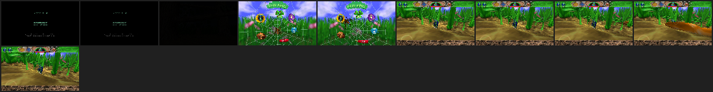

# Compatibility

_Generated by `orbistoun-cli compat markdown` from the records in `compat/`. Do not edit by hand; re-run it. Ranked by how far each guest got - reach, then distinct imports, then how many of those imports were **answered** by something real, then standing, then frames, then calls._

**Answered** is how many of the imports a title called landed on a real implementation rather than a placeholder. It is counted in **functions**, not calls: a percentage of calls belongs to whatever the guest loops on, which is why `standing` beside it could not see a day that took one title from 35 unanswered functions to 20 (D563). A dash means the run predates the measurement. **Reach** climbs `rejected`, `parsed`, `linked`, `entered`, `exited`, `flipped`, `presented` - `flipped` means the guest got a frame to the output layer, a place reached and not a picture shown (D558); `presented`, the top rung, means a frame reached the flipped buffer: one orbistoun drew and wrote back into it, or, where nothing was drawn, the guest's own buffer reading back non-zero (D694, D714) - a frame delivered, not yet a picture checked. **From** is `run` for a result measuring the emulator as it stands and `experiment` for a run resting on an answer nothing measured (less comparable - D181, D557); an answer taken from the target is not a prop. A 📷 marks a guest with a captured framebuffer; see the Screenshots section.

| Title | Reach | Imports | Answered | Calls | Standing | Outcome | From | Measured | On hardware | Preview |
|---|---|--:|--:|--:|--:|---|---|---|---|---|
| [Summer Sports Games](docs/titles/PPSA03416-app0.md) | presented | 426 | 419 | 23836657 | 100% | ran to the time limit | run | 2026-10-12 | unknown | - |
| [Alex Kidd in Miracle World DX](docs/titles/PPSA02664-app0.md) | presented | 399 | 391 | 14884460 | 100% | ran to the time limit | run | 2026-10-12 | renders | - |
| [Terminator 2D: NO FATE](docs/titles/PPSA25872-app0.md) | presented | 378 | 366 | 22349725 | 100% | ran to the time limit | run | 2026-10-13 | unknown | presented at 369, needs 0 |
| [obSCEne](docs/titles/obscene-probe-prospero-native.md) | presented | 223 | 211 | 39546 | 100% | ran to the time limit | run | 2026-09-28 | unknown | - |
| [obSCEne](docs/titles/PPSA99980.md) | presented | 215 | 206 | 416694 | 100% | ran to the time limit | run | 2026-09-28 | unknown | - |
| [Earthion](docs/titles/PPSA28061-app0.md) | presented | 165 | 159 | 20457365 | 100% | ran to the time limit | run | 2026-10-13 | unknown | - |
| [SuperTuxKart](docs/titles/STKT00001.md) | presented | 150 | 149 | 7911373 | 100% | ran to the time limit | run | 2026-10-13 | unknown | - |
| [Craft](docs/titles/CRFT00001.md) | presented | 106 | 100 | 345461 | 100% | ran to the time limit | run | 2026-10-09 | unknown | - |
| [Mesa Cube](docs/titles/MCUB00001.md) | presented | 81 | 80 | 166350 | 100% | ran to the time limit | run | 2026-10-13 | unknown | - |
| [OpenGL CTS](docs/titles/GCTS00001.md) | presented | 79 | 78 | 1069857 | 100% | the guest called abort | run | 2026-10-13 | unknown | - |
| [2 Ship 2 Harkinian](docs/titles/TSHP00001.md) | presented | 72 | 68 | 3421974 | 100% | ran to the time limit | run | 2026-10-09 | unknown | - |
| [Ship of Harkinian](docs/titles/SOHK00001.md) | presented | 72 | 67 | 4303539 | 100% | ran to the time limit | run | 2026-10-09 | unknown | - |
| [OOPSy-DAISY](docs/titles/OPSY00001.md) | presented | 65 | 57 | 23006 | 100% | ran to the time limit | run | 2026-09-28 | unknown | - |
| [Bugdom 2](docs/titles/BGII00001.md) | presented | 55 | 47 | 6267850 | 100% | ran to the time limit | run | 2026-09-28 | unknown | - |
| [Bugdom](docs/titles/BUGD00001.md) 📷 | presented | 55 | 47 | 88848677 | 100% | ran to the time limit | run | 2026-09-28 | unknown | - |
| [Neverball](docs/titles/NVRB00001.md) | presented | 55 | 47 | 76909371 | 100% | ran to the time limit | run | 2026-09-28 | unknown | - |
| [Neverputt](docs/titles/NVPT00001.md) | presented | 53 | 45 | 72190754 | 100% | ran to the time limit | run | 2026-09-28 | unknown | - |
| [Extreme Tux Racer](docs/titles/ETXR00001.md) | presented | 50 | 42 | 10538918 | 100% | ran to the time limit | run | 2026-09-28 | unknown | - |
| [SeaShell](docs/titles/SCSH00001.md) | presented | 40 | 27 | 9205 | 100% | ran to the time limit | run | 2026-09-28 | unknown | - |
| [GL1 Cube](docs/titles/GLCB00001.md) | presented | 32 | 25 | 4146360 | 100% | ran to the time limit | run | 2026-09-28 | unknown | - |
| [Net Tool](docs/titles/NETT00001.md) | presented | 31 | 26 | 32473 | 100% | ran to the time limit | run | 2026-09-28 | unknown | - |
| [OOPS Gallery](docs/titles/GALR00001.md) | presented | 27 | 25 | 24999 | 100% | ran to the time limit | run | 2026-09-28 | unknown | - |
| [Pad Visualizer](docs/titles/PADV00001.md) | presented | 21 | 19 | 33982 | 100% | ran to the time limit | run | 2026-09-28 | unknown | - |
| [Mesa Demos](docs/titles/MDEM00001.md) | flipped | 94 | 93 | 236798 | 100% | ran to the time limit | run | 2026-10-13 | unknown | - |
| [GL2 Cube](docs/titles/GLTC00001.md) | flipped | 24 | 24 | 19886 | 100% | ran to the time limit | run | 2026-10-13 | unknown | - |
| [ASTRO BOT](docs/titles/PPSA21564-app0.md) | entered | 263 | 243 | 1201761 | 100% | ran to the time limit | run | 2026-10-12 | unknown | entered at 282, needs 0 |
| [Grand Theft Auto V](docs/titles/PPSA04263-app0.md) | entered | 213 | 204 | 20000000 | 100% | spent its call budget | run | 2026-10-13 | unknown | entered at 263, needs 1 |
| [DRI Probe](docs/titles/DRIP00001.md) | entered | 62 | 56 | 63336 | 100% | ran to the time limit | run | 2026-09-28 | unknown | - |
| [Mesa Probe](docs/titles/MESA00001.md) | entered | 33 | 32 | 362 | 100% | ran to the time limit | run | 2026-10-13 | unknown | - |
| [GL2 Probe](docs/titles/GLTP00001.md) | entered | 20 | 20 | 101253 | 100% | ran to the time limit | run | 2026-10-13 | unknown | - |
| [GL1 Probe](docs/titles/GLPB00001.md) | entered | 18 | 18 | 30048 | 100% | ran to the time limit | run | 2026-09-28 | unknown | - |
| [BFpilot_v0.4.4](docs/titles/BFpilot_v0.4.4.md) | entered | 0 | - | 0 | 100% | 0x1 | experiment | 2026-08-31 | unknown | - |
| [BackPork_0.1](docs/titles/BackPork_0.1.md) | entered | 0 | - | 0 | 100% | 0x1 | experiment | 2026-08-31 | unknown | - |
| [CheatRunner_v0.17](docs/titles/CheatRunner_v0.17.md) | entered | 0 | - | 0 | 100% | 0x1 | experiment | 2026-08-31 | unknown | - |
| [Lapy-JB-Daemon_v1.2](docs/titles/Lapy-JB-Daemon_v1.2.md) | entered | 0 | - | 0 | 100% | 0x1 | experiment | 2026-08-31 | unknown | - |
| [ShadowMountPlus_1.6beta16](docs/titles/ShadowMountPlus_1.6beta16.md) | entered | 0 | - | 0 | 100% | 0x1 | experiment | 2026-08-31 | unknown | - |
| [WebKit-Autoloader-Installer_v0.4.0](docs/titles/WebKit-Autoloader-Installer_v0.4.0.md) | entered | 0 | - | 0 | 100% | 0x1 | experiment | 2026-08-31 | unknown | - |
| [dist](docs/titles/dist.md) | entered | 0 | 0 | 0 | 100% | 0x1 | run | 2026-09-10 | unknown | - |
| [elfldr_v0.26](docs/titles/elfldr_v0.26.md) | entered | 0 | - | 0 | 100% | 0x1 | experiment | 2026-08-31 | unknown | - |
| [etaHEN_2.5B](docs/titles/etaHEN_2.5B.md) | entered | 0 | - | 0 | 100% | 0x1 | experiment | 2026-08-31 | unknown | - |
| [ftpsrv-drakmor_1.15-ng-stable](docs/titles/ftpsrv-drakmor_1.15-ng-stable.md) | entered | 0 | - | 0 | 100% | 0x1 | experiment | 2026-08-31 | unknown | - |
| [ftpsrv_v0.21.1](docs/titles/ftpsrv_v0.21.1.md) | entered | 0 | - | 0 | 100% | 0x1 | experiment | 2026-08-31 | unknown | - |
| [garlic-savemgr_v1.13](docs/titles/garlic-savemgr_v1.13.md) | entered | 0 | - | 0 | 100% | 0x1 | experiment | 2026-08-31 | unknown | - |
| [klogsrv_v0.9](docs/titles/klogsrv_v0.9.md) | entered | 0 | - | 0 | 100% | 0x1 | experiment | 2026-08-31 | unknown | - |
| [kstuff-lite_v1.10](docs/titles/kstuff-lite_v1.10.md) | entered | 0 | - | 0 | 100% | 0x1 | experiment | 2026-08-31 | unknown | - |
| [kstuff-toggle_0.6](docs/titles/kstuff-toggle_0.6.md) | entered | 0 | - | 0 | 100% | 0x1 | experiment | 2026-08-31 | unknown | - |
| [kstuff_v1.6.7](docs/titles/kstuff_v1.6.7.md) | entered | 0 | - | 0 | 100% | 0x1 | experiment | 2026-08-31 | unknown | - |
| [nanoDNS_0.4](docs/titles/nanoDNS_0.4.md) | entered | 0 | - | 0 | 100% | 0x1 | experiment | 2026-08-31 | unknown | - |
| [pldmgr_v0.5.1](docs/titles/pldmgr_v0.5.1.md) | entered | 0 | - | 0 | 100% | 0x1 | experiment | 2026-08-31 | unknown | - |
| [prosperous](docs/titles/prosperous.md) | entered | 0 | - | 0 | 100% | 0x1 | experiment | 2026-08-31 | unknown | - |
| [ps5-app-dumper_v1.11](docs/titles/ps5-app-dumper_v1.11.md) | entered | 0 | - | 0 | 100% | 0x1 | experiment | 2026-08-31 | unknown | - |
| [ps5-linux-loader_v2.4](docs/titles/ps5-linux-loader_v2.4.md) | entered | 0 | - | 0 | 100% | 0x1 | experiment | 2026-08-31 | unknown | - |
| [ps5-web-file-manager_v1.7](docs/titles/ps5-web-file-manager_v1.7.md) | entered | 0 | - | 0 | 100% | 0x1 | experiment | 2026-08-31 | unknown | - |
| [ps5debug-NG_1.3.0](docs/titles/ps5debug-NG_1.3.0.md) | entered | 0 | - | 0 | 100% | 0x1 | experiment | 2026-08-31 | unknown | - |
| [ps5upload_v5.14.0](docs/titles/ps5upload_v5.14.0.md) | entered | 0 | - | 0 | 100% | 0x1 | experiment | 2026-08-31 | unknown | - |
| [shsrv_v0.20](docs/titles/shsrv_v0.20.md) | entered | 0 | - | 0 | 100% | 0x1 | experiment | 2026-08-31 | unknown | - |
| [websrv_v0.34](docs/titles/websrv_v0.34.md) | entered | 0 | - | 0 | 100% | 0x1 | experiment | 2026-08-31 | unknown | - |
| [zftpd_v1.5.0](docs/titles/zftpd_v1.5.0.md) | entered | 0 | - | 0 | 100% | 0x1 | experiment | 2026-08-31 | unknown | - |

## Screenshots

### BUGD00001

